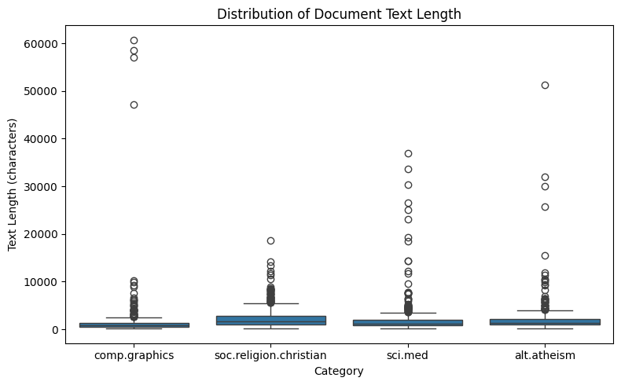
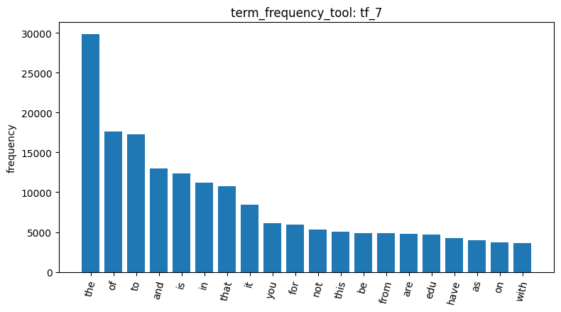
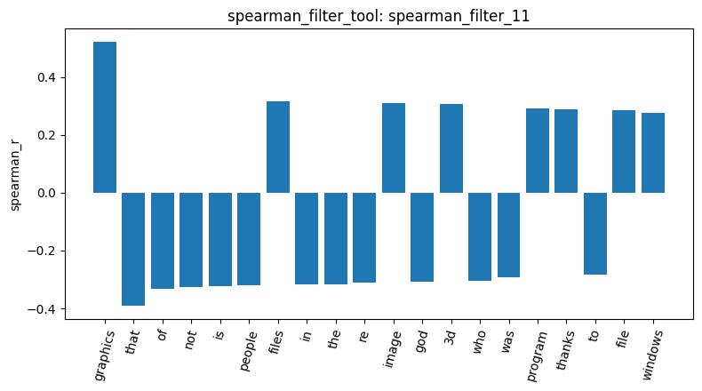
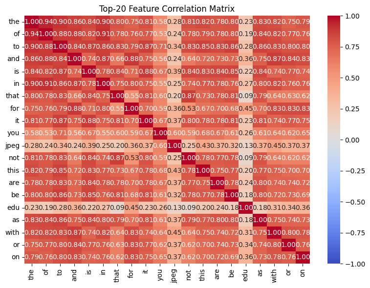
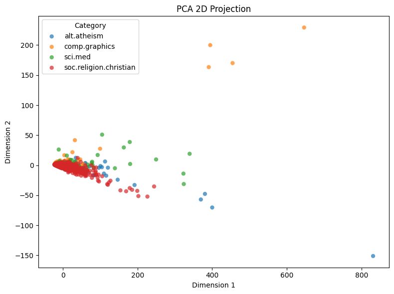
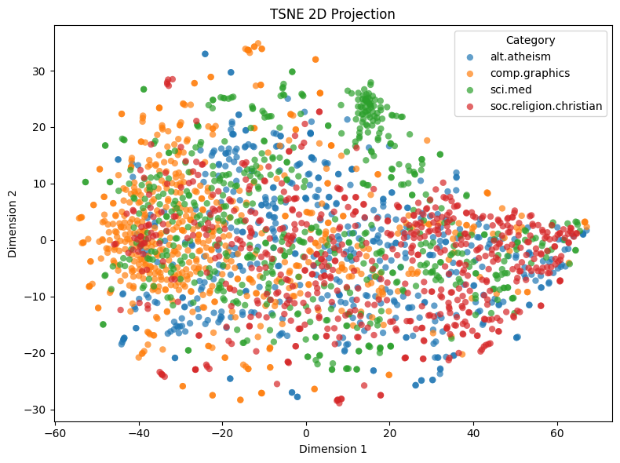
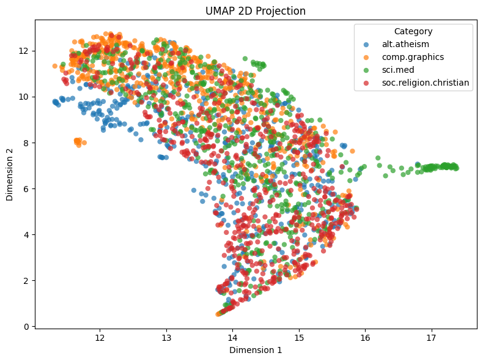

# Agentic Pipeline Report: 20 Newsgroups

## 1. Data

I used the analysis agent with my own 18 tools on a subset of 20 Newsgroups: 2,257 posts from 4 categories (alt.atheism, comp.graphics, sci.med, soc.religion.christian). After loading it (`load_dataset_1`), the preview (`inspect_data_2`) showed that the posts are old emails, so each one still has header lines like "From:", "Subject:" and "Organization:". I also checked for missing values and duplicates (check_missing_3, check_duplicates_4), and found none, so no cleaning was needed. `describe_data_5` showed the posts are long (median about 1,235 characters) but very right-skewed: most posts are moderate, while a few are huge, especially in comp.graphics, where some posts likely contain code or file listings.

## 2. Words, stopwords and headers

build_dtm_tool (`dtm_6`) turned the posts into a document-term matrix with 35,788 words, 99.55% zeros. I built it without removing stopwords, and that shaped everything after it. term_frequency_tool (`tf_7`) showed the classic Zipf pattern: a handful of words appear extremely often and most words are rare, and the top words were all stopwords ("the", "of", "to"...), plus "edu", which comes from university email addresses in the headers. The variance filter (`variance_filter_9`, threshold 0.01) kept 5,354 words, with real topic words like "jpeg" among them.

## 3. Which words point to comp.graphics

I then asked which words go with comp.graphics. Pearson (`pearson_filter_10`) was disappointing: the top words included "thanks", "re" and "writes", which come from how people write emails and replies rather than from graphics itself, and the strongest correlation was only 0.28. Spearman (`spearman_filter_11`) did much better: "graphics" jumped to the top with 0.52 (vs 0.18 in Pearson), followed by "files", "image", "3d" and "program". Pearson gets thrown off by a few posts that use a word many times, while Spearman only cares whether graphics posts consistently rank higher. Interestingly, stopwords like "that", "of", "the" and "not" came out negative, meaning graphics posts use them less than the religion posts, which tend to be long arguments. The feature correlation matrix (`feature_correlation_matrix_12`) explained this: the stopwords correlate with each other at 0.75–0.94, not because they mean anything together, but because long posts contain all of them. Post length was secretly driving a lot of the results.

## 4. Frequent patterns

The first pattern mining run (patterns_13) returned 999 patterns, but they were dominated by email header words, which appear in almost every post and tell us nothing about the topic. Switching to MaxFPGrowth (`patterns_14`), which only keeps the biggest groups, cut this down to 52 maximal patterns, and real topic words like "graphics" and "image" finally showed up.

## 5. Maps of the posts, and the takeaway

PCA (`reduce_dim_15`) explained 72.47% of the variation in just two directions, which sounds great, but the plot shows one dense blob with a few far-away outliers: those directions mostly capture post length, not topic. t-SNE (`reduce_dim_16`) and UMAP (`reduce_dim_17`) did much better: comp.graphics sits on one side, soc.religion.christian on the other, and sci.med forms its own tight group, though the middle is still mixed, and alt.atheism overlaps heavily with christian since both talk about religion. My main takeaway is that word counts can separate topics, but only once you deal with the noise: stopwords, email headers and post length were the biggest "signals" in almost every step, so in a real project I'd remove stopwords and strip headers before anything else.

