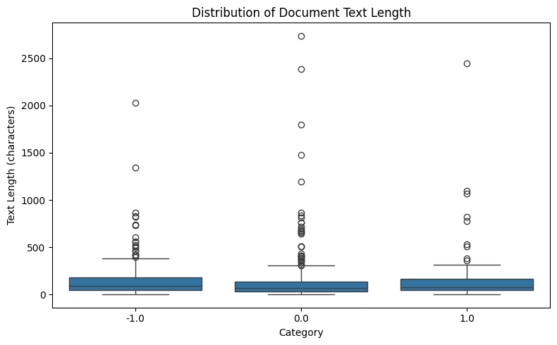
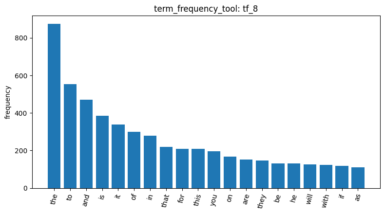
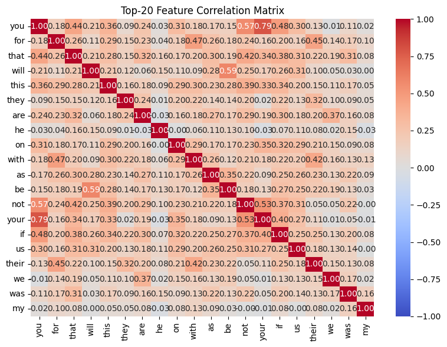
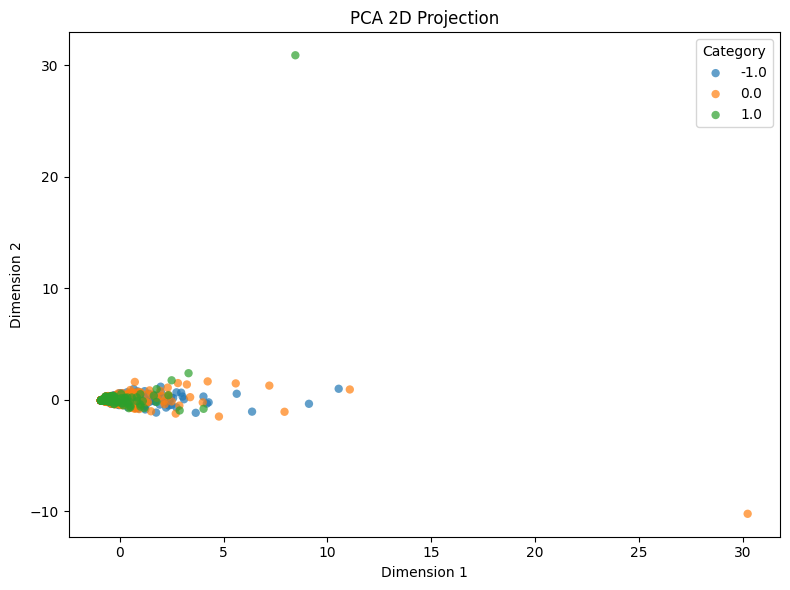
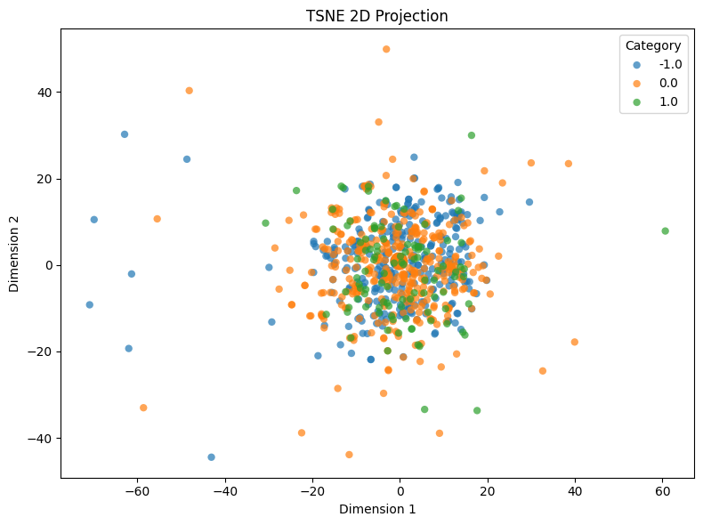
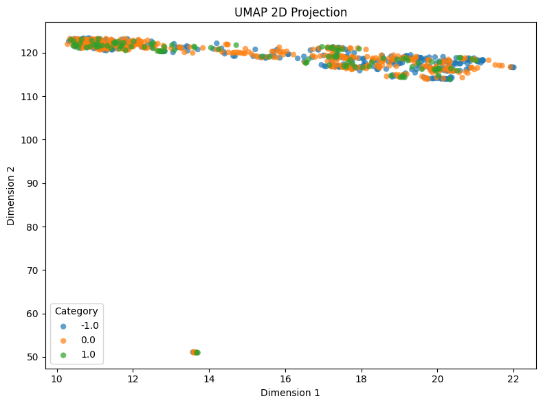

# Homework Report: Reddit Stock Sentiment

## 1. Data and cleaning

For this homework, I ran the same tools I built in the AgentDev notebook on a new dataset: Reddit posts about stocks, each labeled with a sentiment. Loading it with load_dataset_tool (`load_dataset_1`) gave 847 posts with 3 labels: negative (-1) 315, neutral (0) 423 and positive (1) 109. There were no missing texts (`check_missing_3`). There were duplicates, though: `check_duplicates_4` found 23 repeated posts, and when I dropped every copy of them (keep=False), 34 rows were removed (`check_duplicates_5`), because some posts were repeated more than twice. That left 813 posts. Interestingly, 32 of the 34 removed rows were neutral, so they were most likely bot or template posts rather than real opinions. Next, `describe_data_6` showed that these posts are really short: the median is only 78 characters, compared with 1,235 in the 20 Newsgroups dataset, about 16x shorter. Negative posts tend to be a bit longer (median 96 vs 68 for neutral), and every class has a long tail of a few very long posts (max 2,737). One more thing to keep in mind: the labels are imbalanced, with positive posts making up only about 13% of the data, so any positive-sentiment result is based on far fewer examples.

## 2. Words and the document-term matrix

Next, I turned the posts into numbers. build_dtm_tool (`dtm_7`) built a document-term matrix (DTM): a table where each row is a post, each column is a word, and each cell counts how often that word appears in that post. It had 4,313 unique words, and 99.52% of the table was zeros, since each post only uses about 20 distinct words. I expected it to be even sparser than 20 Newsgroups (99.55%), but I was wrong: the posts are shorter, but the vocabulary is also about 8x smaller (4,313 vs 35,788), so the ratio barely changed. Then term_frequency_tool (`tf_8`) showed the top 20 words were all stopwords ("the", "to", "and"...), with no stock tickers at all. I wanted to remove stopwords, and the agent claimed build_dtm_tool supported that, but when I checked the code it didn't. As a workaround, I rebuilt the DTM with max_df=0.2 (`dtm_9`), which drops any word that appears in more than 20% of posts. Only 7 words were removed, but they made up about 10% of all word occurrences. The new top words (`tf_10`) were still mostly stopwords, but one of them, "not" (103 times), actually matters for sentiment ("good" vs "not good"), so I kept dtm_9 instead of cutting deeper. The heatmap (`dtm_heatmap_11`) showed the sparsity directly: 99 of 100 cells were zero. Finally, variance_filter_tool (`variance_filter_12`) kept 483 of the 4,306 words. It flagged noise like the ID-like "01378", but also real stock slang like "100x" and "10k", which are meaningful but too rare to pass the filter.

## 3. Which words signal sentiment

To find out which words go with each sentiment, I used the correlation filters. They score every word by how strongly it goes with one label (that label vs. everything else) and keep the top ones. For positive posts, Pearson (`pearson_filter_13`) gave words like "huge", "tldr" and "rklb", but when I checked the raw counts, many of them appear in only 2 posts, both positive. Nine words were even tied at exactly r = 0.1276 because they all share that same 2-posts pattern. That's coincidence, not real signal; only "technology" (7 posts) and "nice" (5 posts) had decent support. These rare words showed up even though they'd fail the variance filter, because variance_filter_tool only flags words and doesn't remove them, so Pearson still scored all 4,306. Spearman (`spearman_filter_14`) gave almost the same list. That makes sense: in short posts almost every count is 0 or 1, so turning counts into ranks changes nothing. This is very different from 20 Newsgroups, where long posts made the two methods disagree a lot. The negative side (`pearson_filter_15`) was much more convincing, since it's backed by 315 posts: the top words were "he", "his", "him", "trump", "china", "trade", "economy" and "americans", plus a lot of profanity. So negative posts here are mostly about politics and the trade war. I also checked how words relate to each other, which helps spot words that carry duplicate information or form phrases. Finally, the feature correlation matrix (`feature_correlation_matrix_16`) showed that words are much more loosely connected than in 20 Newsgroups (mostly 0.1–0.3 vs 0.75–0.94). The strongest pairs were you/your/not/if, which looks like people arguing with each other, and will/be, the "will be" prediction phrase.

## 4. Frequent patterns

Next, I used mine_patterns_tool (`patterns_17`) to look for words that keep showing up together in negative posts, kind of like finding items that always end up in the same shopping basket. I used MaxFPGrowth with a minimum support of 5, so a word combination only counts if it appears in at least 5 posts, and "maximal" means we only keep the biggest group instead of listing every smaller piece of it. It found 146 patterns, but almost all of them were single words, like "don", "time" and "point". This makes sense: the posts are so short that the same pair of words rarely repeats in 5 different posts. The one clear pair was "trump + people" (9 posts), which matches the Pearson result that negative posts are mostly about Trump. One funny artifact: "don" is actually "don't" cut in half, because the tokenizer splits words at the apostrophe.

## 5. Visualizing the posts, and the big takeaway

Finally, I squeezed the posts onto 2D maps with reduce_dimensions_tool, where similar posts should sit close together, to see if each sentiment forms its own group. PCA (`reduce_dim_18`) only captured about 20% of the information (vs 72% for 20 Newsgroups), and two lonely dots far from the rest are most likely the two longest posts; the three sentiments were completely mixed. t-SNE (`reduce_dim_19`) gave one big blob with every sentiment mixed together, and UMAP (`reduce_dim_20`) was also mixed, except for a tiny island of posts stacked in one spot, probably posts with almost no usable words (like just a link or an emoji). I also turned the labels into one-hot columns with binarize_labels_tool (`binarize_labels_21`): 3 columns, one switch per sentiment, with counts matching the cleaned data (315 / 391 / 107). One thing lost here is that sentiment actually has an order (negative < neutral < positive), which one-hot ignores. The cosine similarity test (`cosine_similarity_22`) explained why no sentiment groups showed up: "this stock is good" and "this stock is not good" scored 0.866, meaning 87% similar, even though they mean the opposite. Counting words simply can't understand "not". So my overall takeaway is that this word-counting approach works well for telling topics apart (like graphics vs religion in 20 Newsgroups), but it's bad at telling feelings apart. To really capture sentiment, we'd need methods that understand word order and negation.

